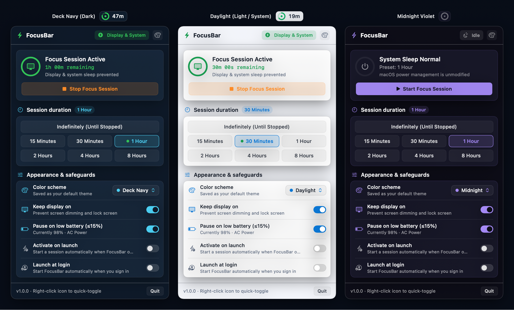

# FocusBar

A lightweight, native macOS menu bar utility that prevents idle display and system sleep during active focus sessions — built with Swift, AppKit, SwiftUI, and `IOKit` power assertions.



## Features

- **Menu Bar Capsule & Progress Ring**: Custom-rendered status bar capsule displaying a live progress ring and compact countdown timer (`47m`, `1:15`, `ON`) while a session is active, collapsing to a minimal ring when idle.
- **One-Click & Timed Focus Sessions**:
  - **Left-click** the menu bar capsule to open the control popover.
  - **Right-click** (or `Option`/`Control`-click) the menu bar capsule to quick-toggle a focus session using your saved preset.
  - Presets for **Indefinitely**, **15 Minutes**, **30 Minutes**, **1 Hour**, **2 Hours**, **4 Hours**, and **8 Hours**.
- **7 Built-in Color Schemes**:
  - **System (Match Mac)** — Automatically switches between **Daylight (Light)** and **Deck Navy (Dark)** whenever macOS appearance changes.
  - **Deck Navy (Default)**, **Daylight (Light)**, **Midnight Violet**, **Terminal Phosphor**, **Solar Amber**, and **Nordic Frost**.
  - Accessible via the header palette button or the **Color scheme** menu in **Appearance & safeguards**; persisted automatically in `UserDefaults`.
- **Power & Battery Safeguards**:
  - **Keep display on**: Toggle between preventing both display + system sleep (`kIOPMAssertionTypePreventUserIdleDisplaySleep`) or keeping only the system awake while allowing the screen to dim/lock (`kIOPMAssertionTypePreventUserIdleSystemSleep`).
  - **Pause on low battery (≤15%)**: Automatically ends the active power assertion when running on battery power at or below 15%, with live battery percentage and power source readout via `IOKit.ps`.
  - **Activate on launch** & **Launch at login** (`SMAppService.mainApp`).

## Requirements

- macOS 13.0 (Ventura) or later
- Swift 5.9+ (Xcode or Xcode Command Line Tools)

## Build & Install

Build the release `.app` bundle (`build/FocusBar.app`):

```bash
./build-app.sh
```

Build and install directly to `~/Applications/FocusBar.app` (or pass a custom target directory such as `/Applications`):

```bash
./build-app.sh --install
# or
./build-app.sh --install /Applications
```

Launch from Terminal:

```bash
open build/FocusBar.app
```

## CLI Flags

- `--show` — Opens the FocusBar popover immediately on launch.
- `--render-preview <path.png>` — Renders a side-by-side PNG preview of the menu bar capsules and themed popovers.
- `--render-icon <path.png>` — Renders the 1024×1024 app icon PNG used to build `Resources/FocusBar.icns`.
